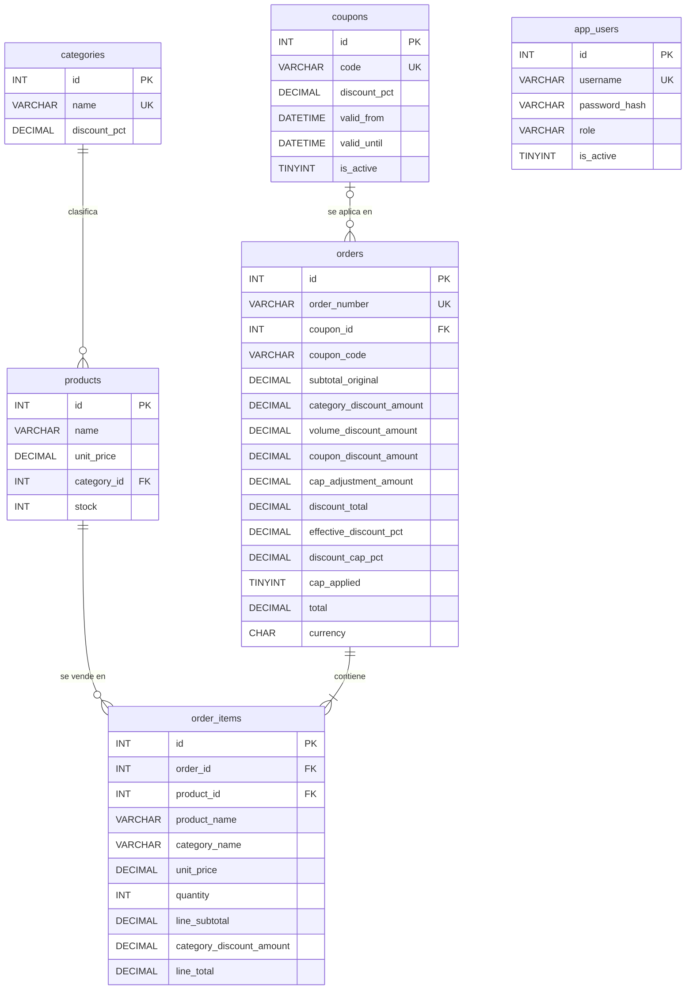

# Base de datos — KATA Core E-Commerce

Motor: **MySQL 5.7.44** · InnoDB · `utf8mb4` / `utf8mb4_unicode_ci` · Base: `kata_ecommerce`

## 1. Decisiones

- 5 tablas de negocio: `categories`, `products`, `coupons`, `orders`, `order_items`. Más una tabla de seguridad, `app_users` (usuarios que pueden obtener un token JWT), sin relación con las demás.
- Sin tabla de carrito: el carrito vive en el frontend y llega completo al checkout.
- Sin clientes, almacenes, movimientos de inventario ni tablas de reglas. `app_users` no representa clientes: las órdenes no se asocian a un usuario.
- Umbral de volumen (100.00 USD), 5 % y tope 35 % son configuración del backend (`discount.volume.threshold`, `discount.volume.pct`, `discount.cap-pct` en `application.properties`), no columnas; el tope se guarda como snapshot en `orders.discount_cap_pct`.
- Importes `DECIMAL(12,2) UNSIGNED`, porcentajes `DECIMAL(5,2) UNSIGNED`. Nunca FLOAT/DOUBLE.
- FKs `ON DELETE RESTRICT ON UPDATE RESTRICT`; las órdenes nunca se borran en cascada.
- Snapshots en `order_items` (nombre, categoría, precio) para preservar el histórico.

## 2. Diccionario de datos

### categories
| Columna | Tipo | Nulo | Default | Descripción |
|---|---|---|---|---|
| id | INT UNSIGNED PK AI | No | — | Identificador |
| name | VARCHAR(100) UNIQUE | No | — | Nombre de categoría |
| discount_pct | DECIMAL(5,2) UNSIGNED | No | 0.00 | % descuento de categoría |
| created_at | DATETIME | No | CURRENT_TIMESTAMP | Creación |
| updated_at | DATETIME | No | CURRENT_TIMESTAMP ON UPDATE | Última actualización |

### products
| Columna | Tipo | Nulo | Default | Descripción |
|---|---|---|---|---|
| id | INT UNSIGNED PK AI | No | — | Identificador |
| name | VARCHAR(150) | No | — | Nombre |
| unit_price | DECIMAL(12,2) UNSIGNED | No | — | Precio unitario USD |
| category_id | INT UNSIGNED FK → categories.id (indexado) | No | — | Categoría |
| stock | INT UNSIGNED | No | 0 | Stock actual |
| created_at / updated_at | DATETIME | No | CURRENT_TIMESTAMP | Auditoría |

### coupons
| Columna | Tipo | Nulo | Default | Descripción |
|---|---|---|---|---|
| id | INT UNSIGNED PK AI | No | — | Identificador |
| code | VARCHAR(50) UNIQUE | No | — | Código |
| discount_pct | DECIMAL(5,2) UNSIGNED | No | — | % del cupón |
| valid_from | DATETIME | No | — | Inicio vigencia |
| valid_until | DATETIME | No | — | Fin vigencia |
| is_active | TINYINT(1) UNSIGNED | No | 1 | 1 activo / 0 inactivo |
| created_at / updated_at | DATETIME | No | CURRENT_TIMESTAMP | Auditoría |

Cupón válido: existe, `is_active = 1` y `NOW() BETWEEN valid_from AND valid_until`.

### orders
| Columna | Tipo | Nulo | Default | Descripción |
|---|---|---|---|---|
| id | INT UNSIGNED PK AI | No | — | Identificador |
| order_number | VARCHAR(30) UNIQUE | No | — | Número de orden |
| coupon_id | INT UNSIGNED FK → coupons.id | Sí | NULL | Cupón aplicado |
| coupon_code | VARCHAR(50) | Sí | NULL | Snapshot del código |
| subtotal_original | DECIMAL(12,2) UNSIGNED | No | — | Σ precio × cantidad |
| category_discount_amount | DECIMAL(12,2) UNSIGNED | No | 0.00 | Paso categoría |
| volume_discount_amount | DECIMAL(12,2) UNSIGNED | No | 0.00 | Paso volumen |
| coupon_discount_amount | DECIMAL(12,2) UNSIGNED | No | 0.00 | Paso cupón |
| cap_adjustment_amount | DECIMAL(12,2) UNSIGNED | No | 0.00 | Recorte por tope |
| discount_total | DECIMAL(12,2) UNSIGNED | No | 0.00 | Descuento final |
| effective_discount_pct | DECIMAL(5,2) UNSIGNED | No | 0.00 | % efectivo |
| discount_cap_pct | DECIMAL(5,2) UNSIGNED | No | 35.00 | Snapshot del tope |
| cap_applied | TINYINT(1) UNSIGNED | No | 0 | 1 si se aplicó tope |
| total | DECIMAL(12,2) UNSIGNED | No | — | Total a pagar |
| currency | CHAR(3) | No | 'USD' | Moneda |
| created_at | DATETIME | No | CURRENT_TIMESTAMP | Creación |

### order_items
| Columna | Tipo | Nulo | Default | Descripción |
|---|---|---|---|---|
| id | INT UNSIGNED PK AI | No | — | Identificador |
| order_id | INT UNSIGNED FK → orders.id | No | — | Orden |
| product_id | INT UNSIGNED FK → products.id (indexado) | No | — | Producto |
| product_name | VARCHAR(150) | No | — | Snapshot nombre |
| category_name | VARCHAR(100) | No | — | Snapshot categoría |
| unit_price | DECIMAL(12,2) UNSIGNED | No | — | Snapshot precio |
| quantity | INT UNSIGNED | No | — | Cantidad |
| line_subtotal | DECIMAL(12,2) UNSIGNED | No | — | precio × cantidad |
| category_discount_amount | DECIMAL(12,2) UNSIGNED | No | 0.00 | Descuento categoría |
| line_total | DECIMAL(12,2) UNSIGNED | No | — | subtotal − desc. categoría |

`UNIQUE(order_id, product_id)`. Los descuentos de volumen, cupón y tope son de cabecera, no se prorratean en líneas.

### app_users
| Columna | Tipo | Nulo | Default | Descripción |
|---|---|---|---|---|
| id | INT UNSIGNED PK AI | No | — | Identificador |
| username | VARCHAR(50) UNIQUE | No | — | Nombre de usuario (login) |
| password_hash | VARCHAR(100) | No | — | Contraseña cifrada con BCrypt (nunca texto plano) |
| role | VARCHAR(30) | No | 'USER' | Rol sin prefijo `ROLE_` (USER, ADMIN) |
| is_active | TINYINT(1) UNSIGNED | No | 1 | 1 puede iniciar sesión / 0 bloqueado |
| created_at / updated_at | DATETIME | No | CURRENT_TIMESTAMP | Auditoría |

El seed carga tres usuarios de prueba: uno `ADMIN`, uno `USER` y uno inactivo para probar el 401. La API solo lee esta tabla (`DatabaseUserDetailsService`); no hay endpoints para gestionar usuarios.

## 3. Diagrama ER



`app_users` no tiene relaciones con las tablas de negocio.

## 4. Cascada de descuentos (la aplica el backend)

Redondeo HALF_UP a 2 decimales al final de cada paso.

1. `subtotal_original = Σ unit_price × quantity`
2. Categoría por línea: `line_subtotal × discount_pct / 100` → `subtotal_1`
3. Volumen: si `subtotal_1 > 100.00` → 5 % → `subtotal_2`
4. Cupón válido: `subtotal_2 × coupon_pct / 100`
5. Tope: si `bruto > subtotal_original × 0.35` → `cap_adjustment = bruto − tope`, `cap_applied = 1`
6. `discount_total = bruto − cap_adjustment`, `total = subtotal_original − discount_total`, `effective_discount_pct = discount_total / subtotal_original × 100`

**Observación:** con solo las 3 reglas el máximo es `1 − 0.90 × 0.95 × 0.85 = 27.325 %`, que no alcanza el 35 %. Por eso existe el cupón de prueba `TESTCAP30` (orden ORD-2026-000004).

## 5. Checkout transaccional (diseño de referencia en SQL)

> **Implementación real en el backend** (`OrderService`, `StockService`, `ProductRepository`). No usa `SELECT ... FOR UPDATE`. Lee los productos con una consulta normal, valida el stock de forma informativa y luego hace un `UPDATE` atómico por producto (en orden de id) con `WHERE stock >= :cantidad`. Si alguno afecta 0 filas, se lanza 409 y se deshace toda la transacción. El resultado es equivalente a los pasos 3–5 de abajo, sin bloqueo previo de filas.

```
START TRANSACTION (nivel REPEATABLE READ, por defecto en InnoDB)
  1. Validar carrito no vacío y quantity > 0          -> si falla: ROLLBACK
  2. Validar cupón (si viene)                          -> si inválido: ROLLBACK
  3. SELECT id, name, unit_price, stock, category_id
       FROM products WHERE id IN (...) ORDER BY id FOR UPDATE
     (orden por id para evitar deadlocks entre checkouts concurrentes)
  4. Validar stock >= cantidad por producto            -> si falla: ROLLBACK
  5. UPDATE products SET stock = stock - :cantidad
       WHERE id = :id AND stock >= :cantidad            (verificar filas afectadas = 1)
  6. Calcular la cascada en el backend
  7. INSERT INTO orders (...)
  8. INSERT INTO order_items (...)
COMMIT
```

Ante stock insuficiente, cupón inválido o carrito vacío: `ROLLBACK` y no se crea la orden.

## 6. Limitaciones (MySQL 5.7 no las garantiza; las valida el backend)

- `quantity > 0` y `unit_price > 0` (5.7 parsea pero ignora `CHECK`).
- Stock no negativo en concurrencia: `UNSIGNED` + modo estricto lanza error al restar por debajo de 0, pero el control correcto es `FOR UPDATE` + validación previa, o bien (como hace el backend) el `UPDATE ... WHERE stock >= :cantidad` comprobando las filas afectadas.
- Vigencia y estado del cupón.
- Todos los cálculos de la cascada y el redondeo HALF_UP.
- `orders` no guarda el % del cupón ni las constantes de volumen (100.00 / 5 %): si cambian, la consulta 4 de validación puede reportar descuadres en órdenes históricas. Solo el tope tiene snapshot.
- `DECIMAL ... UNSIGNED` está obsoleto en MySQL 8.0.17+ (funciona en 5.7).
- `ROUND()` de MySQL sobre DECIMAL redondea "half away from zero", equivalente a HALF_UP para importes positivos.

## 7. Orden de ejecución

Desde `examen-ecommerce/`:

```bash
mysql -u root -p < docs/db_kata_ecommerce/00_create_database.sql
mysql -u root -p < docs/db_kata_ecommerce/01_schema.sql
mysql -u root -p < docs/db_kata_ecommerce/02_seed_data.sql
mysql -u root -p < docs/db_kata_ecommerce/03_validation_queries.sql
```

Cada script fija `SET NAMES`, `sql_mode` de sesión y `USE kata_ecommerce`. `01_schema.sql` elimina y recrea las tablas, incluida `app_users`.

`04_auth_users.sql` es solo para una base **ya existente** creada antes de la autenticación JWT: crea `app_users` y carga los usuarios de prueba sin tocar las demás tablas. Es re-ejecutable (`CREATE TABLE IF NOT EXISTS` + `INSERT ... ON DUPLICATE KEY`). En una instalación nueva no hace falta.

```bash
mysql -u root -p < docs/db_kata_ecommerce/04_auth_users.sql
```
